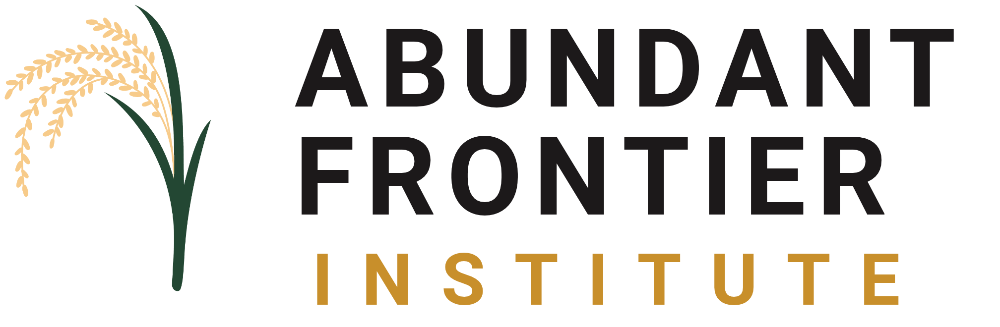
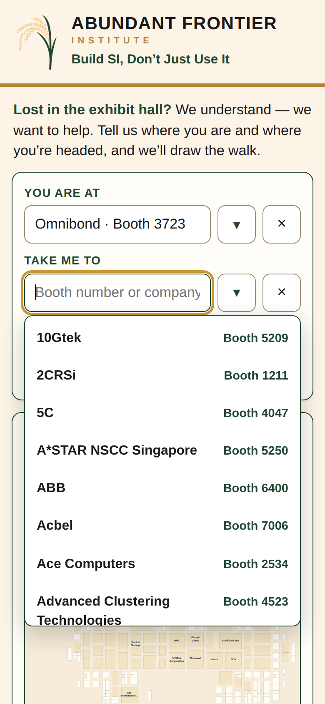
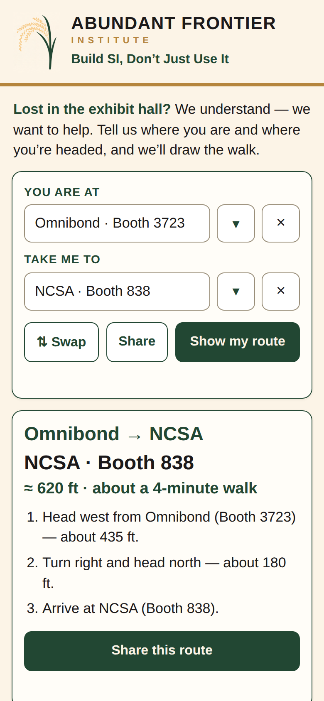
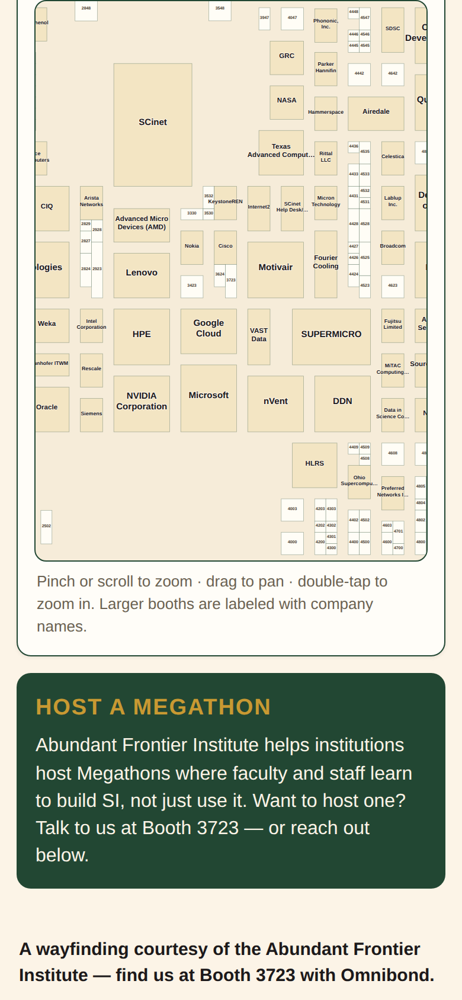
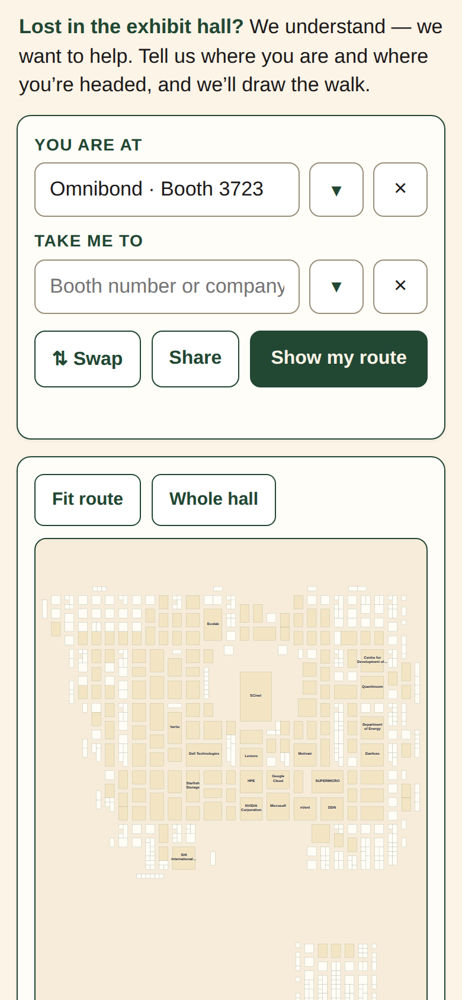

# SC26 Hall Wayfinder

**Build SI, Don't Just Use It.**

Find your way around the SC26 exhibit hall — pick where you are and where you're headed, and get a walking route drawn on the official floor plan. A courtesy of the Abundant Frontier Institute, Booth 3723.

**Live site:** https://abundantfrontier.github.io/sc26-wayfinder/

## Why this exists

The SC26 exhibit floor is enormous — 600 exhibitors spread across two halls at McCormick Place — and people get lost in it constantly. Je'aime Powell of the Abundant Frontier Institute had the idea: put a sign at Booth 3723 that says *"Are you lost? We understand — we want to help,"* with a QR code and NFC tag that open this wayfinder on the attendee's phone. It starts at Booth 3723 by default (that's where the sign stands), but the starting point can be changed to any booth, so anyone can use it from anywhere in the hall.

## Screenshots

| Pick a booth — search or browse | Your route |
| --- | --- |
|  |  |

| Starting view at Booth 3723 | The whole hall |
| --- | --- |
|  |  |

## How it was made

**Built 100% by SI agents — no human wrote a line of code.** The wayfinder was designed, built, and tested entirely by SI agents (Anna, with Claude Code) working under Je'aime Powell's direction for the Abundant Frontier Institute.

- **Floor data.** The map is drawn from the official floor plan's own CAD export: the DWG file offered by the SC26 interactive floor plan was parsed with [LibreDWG](https://www.gnu.org/software/libredwg/) (open source), yielding the exact geometry and exhibitor name of all 600 booths.
- **Routing.** Booths were turned into an aisle network (a grid graph over the hall's walkable aisles) and routes are computed with an A* shortest-path search, then simplified into plain-language walking directions.
- **Testing.** Automated suites verify the build before it ships: Node checks confirm every one of the 599 other booths routes successfully from Booth 3723 with zero paths crossing a booth, and a regression check holds the Omnibond → NCSA route at ≈616 ft against the hand-drawn reference map. Real-browser checks at a phone viewport (390×844) cover the default start, the exhibitor picker, share-link round-trips, and opening the page offline from `file://` (the booth data is embedded in `app.js`; `booths.json` is the source copy).
- **Refinements.** Both fields are searchable comboboxes — tap to browse the full scrollable A–Z exhibitor list, or type to filter with ranked suggestions — and exhibitor names on the map scale with booth size so the big booths work as landmarks.
- **Tech.** One static page in vanilla HTML/CSS/JS. No build step, no external requests, ~115 KB total — it loads fast on congested conference Wi-Fi and is hosted on GitHub Pages from this repo's `main` branch.

## Reference data

- **Official SC26 interactive exhibit floor plan** (Hallerickson / Ungerboeck), reached from SC26's [Navigating SC](https://sc26.supercomputing.org/community-engagement/navigating-sc/) page. Booth numbers, exhibitor names, and booth geometry come from that plan's own exports (DWG and PDF), retrieved November 13, 2026.
- **Venue:** McCormick Place, Chicago — Exhibit Halls F1 and F2.
- Exhibitor names and booth assignments belong to SC26 and the exhibitors. This is an unofficial courtesy tool offered by the Abundant Frontier Institute, an SC26 exhibitor; it is not published by SC26.

## About the Abundant Frontier Institute

The Abundant Frontier Institute is a 501(c)(3) tax-exempt nonprofit research institute helping institutions build SI capability — including hosting Megathons where faculty and staff learn to build SI, not just use it.

[abundantfrontier.org](https://abundantfrontier.org) · contact@abundantfrontier.org · Booth 3723 (with Omnibond)

## License

MIT — see [LICENSE](LICENSE). Copyright © 2026 Abundant Frontier Institute. The license covers the code; exhibitor names and booth data are credited under Reference data above.

## Publishing note

The AFI logo is embedded in `index.html` as a data URI because the publishing tool used for this repo moves text files only; the `docs/` images live in this repo alongside it. The canonical project source (with `assets/afi-logo.png` as a separate file) is maintained by the Institute, and this repo holds the publish copy generated from it.
